<a href="https://wajahatalinaqvi.github.io">
  <picture>
    <source media="(prefers-color-scheme: dark)" srcset="./assets/hero-dark.svg" />
    
  </picture>
</a>

<h1 align="center">Wajahat Naqvi — Shopify Full-Stack Developer</h1>

<p align="center">
  Shopify app developer and full-stack engineer based in Lahore, Pakistan, building with Shopify Liquid, React, Next.js, Laravel, GraphQL, APIs, ecommerce automation, and practical AI workflows.
</p>

<p align="center">
  <a href="https://wajahatalinaqvi.github.io"><picture><source media="(prefers-color-scheme: dark)" srcset="./assets/btn-portfolio-dark.svg" /></picture></a>
  <a href="https://github.com/wajahatalinaqvi?tab=repositories"><picture><source media="(prefers-color-scheme: dark)" srcset="./assets/btn-projects-dark.svg" /></picture></a>
  <a href="https://www.linkedin.com/in/wajahatnaqvi-developer/"><picture><source media="(prefers-color-scheme: dark)" srcset="./assets/btn-linkedin-dark.svg" /></picture></a>
  <a href="mailto:wajahatalinaqvi929@gmail.com"><picture><source media="(prefers-color-scheme: dark)" srcset="./assets/btn-email-dark.svg" /></picture></a>
</p>

<p align="center">
  <a href="#build-mode"><b>Build mode</b></a> &nbsp;·&nbsp;
  <a href="#featured-builds"><b>Featured builds</b></a> &nbsp;·&nbsp;
  <a href="#stack-i-reach-for"><b>Stack</b></a> &nbsp;·&nbsp;
  <a href="#github-signal"><b>GitHub signal</b></a> &nbsp;·&nbsp;
  <a href="#lets-build-something-useful"><b>Contact</b></a>
  <br /><br />
  
</p>

<picture><source media="(prefers-color-scheme: dark)" srcset="./assets/divider-dark.svg" /></picture>

## Build mode

I’m a **Shopify-focused full-stack developer** who likes solving the part of a product that actually makes it useful — not just the screen people see.

I work across **storefront UX, embedded apps, backend systems, integrations, queues, dashboards, automation, and AI-assisted workflows**.

<picture>
  <source media="(prefers-color-scheme: dark)" srcset="./assets/build-loop-dark.svg" />
  
</picture>

> **Current direction:** full-stack product engineering with deep Shopify expertise, strong React/Laravel foundations, and practical AI integrations.

<details>
<summary><b>Open my build philosophy</b></summary>
<br />

```text
Useful > flashy
Clear > clever
Maintainable > magical
Measured automation > blind automation
Ship → observe → improve
```

I care about product decisions as much as implementation: what deserves automation, where humans should stay in the loop, and how the interface communicates system state.

</details>

<picture><source media="(prefers-color-scheme: dark)" srcset="./assets/divider-dark.svg" /></picture>

## Featured builds

<p align="center">
  <a href="https://github.com/wajahatalinaqvi/linkedin-pro-agent"><picture><source media="(prefers-color-scheme: dark)" srcset="./assets/card-linkedin-pro-agent-dark.svg" /></picture></a>
  <a href="https://github.com/wajahatalinaqvi/brainxTest-wishlist-app"><picture><source media="(prefers-color-scheme: dark)" srcset="./assets/card-shopify-wishlist-api-dark.svg" /></picture></a>
  <a href="https://github.com/wajahatalinaqvi/quickdebugger"><picture><source media="(prefers-color-scheme: dark)" srcset="./assets/card-quickdebugger-dark.svg" /></picture></a>
  <a href="https://github.com/wajahatalinaqvi/DjordanMedia-v2"><picture><source media="(prefers-color-scheme: dark)" srcset="./assets/card-djordanmedia-v2-dark.svg" /></picture></a>
</p>

<details>
<summary><b>Read the build notes</b></summary>
<br />

| Build | What it does | Stack |
|---|---|---|
| [LinkedIn Pro Agent](https://github.com/wajahatalinaqvi/linkedin-pro-agent) | Researches verified tech stories, scores them, prepares LinkedIn + X content, generates previews, and keeps final publishing under human approval. | Python · GitHub Actions · Playwright · LinkedIn API · content scoring · V3 carousel rendering |
| [Shopify Customer Wishlist API](https://github.com/wajahatalinaqvi/brainxTest-wishlist-app) | Stores customer wishlists directly in **Shopify metafields** and resolves saved products through the Admin API. | Node.js · Express · Shopify Admin API · Netlify Functions · Liquid |
| [quickdebugger](https://github.com/wajahatalinaqvi/quickdebugger) | Wraps async functions and surfaces **execution time, memory usage, and error traces** during debugging. | JavaScript · Node.js · React-friendly instrumentation |
| [DjordanMedia v2](https://github.com/wajahatalinaqvi/DjordanMedia-v2) | Shopify theme development with custom **Liquid sections, snippets, templates, assets, and storefront UX**. | Shopify Liquid · JavaScript · CSS · Theme architecture |

</details>

<picture><source media="(prefers-color-scheme: dark)" srcset="./assets/divider-dark.svg" /></picture>

## Stack I reach for

<p align="center">
  <picture>
    <source media="(prefers-color-scheme: dark)" srcset="https://skillicons.dev/icons?i=js,ts,react,nextjs,laravel,php,nodejs,html,css,tailwind,postgres,redis,git,github,vscode&perline=8&theme=dark" />
    
  </picture>
</p>

<p align="center">
  <picture>
    <source media="(prefers-color-scheme: dark)" srcset="./assets/stack-tools-dark.svg" />
    
  </picture>
</p>

### What I like building

| 🛍️ Commerce | 🧩 Product engineering | 🤖 AI + automation |
|---|---|---|
| Shopify apps | React / Next.js interfaces | Research & content agents |
| Theme architecture | Laravel APIs | Human-in-the-loop workflows |
| Checkout / post-purchase UX | Dashboards & admin systems | AI-assisted analysis |
| Storefront performance | Webhooks, queues & integrations | Tool orchestration |

<picture><source media="(prefers-color-scheme: dark)" srcset="./assets/divider-dark.svg" /></picture>

## GitHub signal

<picture>
  <source media="(prefers-color-scheme: dark)" srcset="https://raw.githubusercontent.com/wajahatalinaqvi/wajahatalinaqvi/output/signal-dark.svg" />
  
</picture>

<details>
<summary><b>Watch the contribution snake</b></summary>
<br />

<picture>
  <source media="(prefers-color-scheme: dark)" srcset="https://raw.githubusercontent.com/wajahatalinaqvi/wajahatalinaqvi/output/snake-dark.svg" />
  
</picture>

<sub>Both visuals are rebuilt daily in this repo by <a href=".github/workflows/signal.yml">a scheduled GitHub Actions workflow</a> — no third-party stats service involved.</sub>

</details>

<picture><source media="(prefers-color-scheme: dark)" srcset="./assets/divider-dark.svg" /></picture>

## How I build

<picture>
  <source media="(prefers-color-scheme: dark)" srcset="./assets/how-i-build-dark.svg" />
  
</picture>

<picture><source media="(prefers-color-scheme: dark)" srcset="./assets/divider-dark.svg" /></picture>

## Let’s build something useful

If you’re working on a **Shopify app, ecommerce experience, React/Laravel product, or AI-powered workflow**, I’m interested in solving the hard part — not just making the interface look finished.

<p align="center">
  <a href="https://wajahatalinaqvi.github.io"><picture><source media="(prefers-color-scheme: dark)" srcset="./assets/btn-portfolio-dark.svg" /></picture></a>
  <a href="https://www.linkedin.com/in/wajahatnaqvi-developer/"><picture><source media="(prefers-color-scheme: dark)" srcset="./assets/btn-linkedin-dark.svg" /></picture></a>
  <a href="mailto:wajahatalinaqvi929@gmail.com"><picture><source media="(prefers-color-scheme: dark)" srcset="./assets/btn-email-dark.svg" /></picture></a>
</p>

<p align="center">
  <sub>Shopify · Full-stack · AI · Automation — Lahore, Pakistan</sub>
</p>
